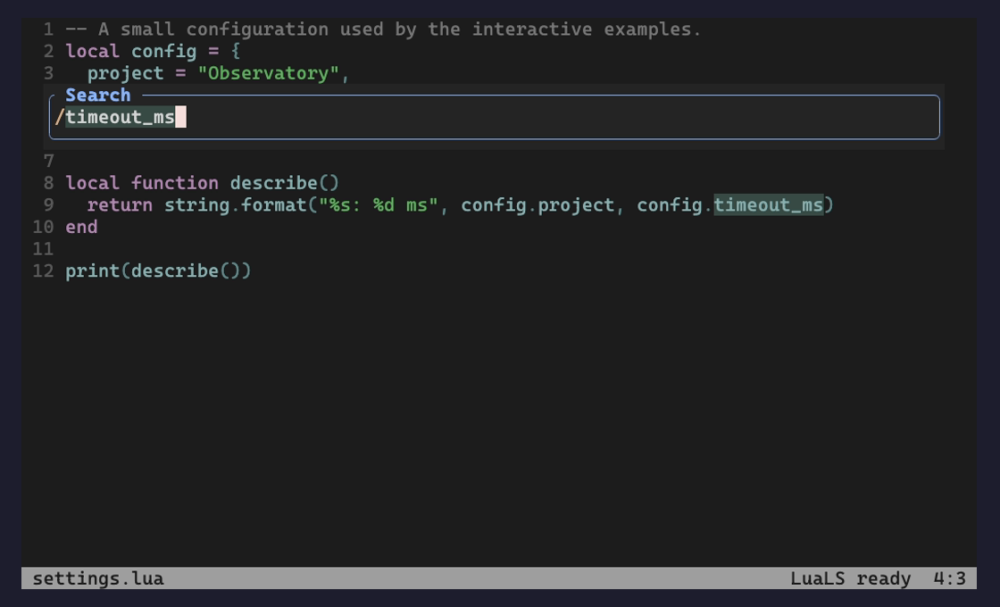

# input-tools.nvim

A floating command-line UI that keeps Neovim editing and completion.



## Features

- Use native commands, search, history and completion in floating windows.
- Handle prompts, choices and confirmations beside the source.
- Integrate optional Vim-mode inputs and notification-tools messages.

## Requirements

Neovim **0.10+**. No runtime dependencies. Use one external command-line UI at a time.

## Installation

With lazy.nvim:

```lua
{
  "Jacky-Lzx/input-tools.nvim",
  main = "input-tools",
  opts = {},
}
```

Or put this repository and its required dependencies on `runtimepath`, then call:

```lua
require("input-tools").setup({})
```

## Usage

```vim
:InputToolsInfo
```

Press `:`, `/` or `?` to use the floating command line with native editing,
history and completion. Other interactive prompts retain their native meanings.

## Documentation

- [Complete reference](doc/input-tools.txt) — `:help input-tools`.
- [Workflow and integration guide](doc/guide.md).
- [More screenshots](doc/gallery.md).
- Diagnose availability with `:checkhealth input-tools`.
- [Scenario checks and screenshot reproduction](docs/workflows.md).

## Development

Run from the repository root:

```sh
python3 tests/run.py unit --filter docs
python3 tests/run.py default
```

See [the test workflow](tests/README.md) for dependencies, optional suites and
retained failure evidence. Local development overrides belong in your package
manager configuration; public installation uses the repository above.

[License](LICENSE).
