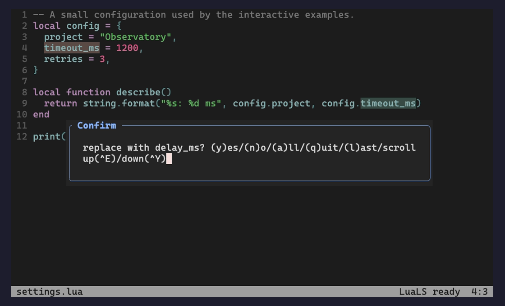
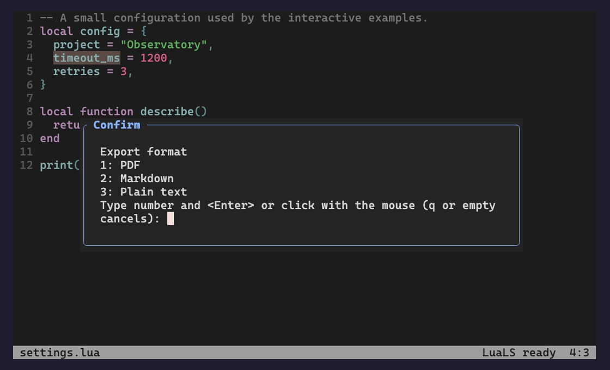
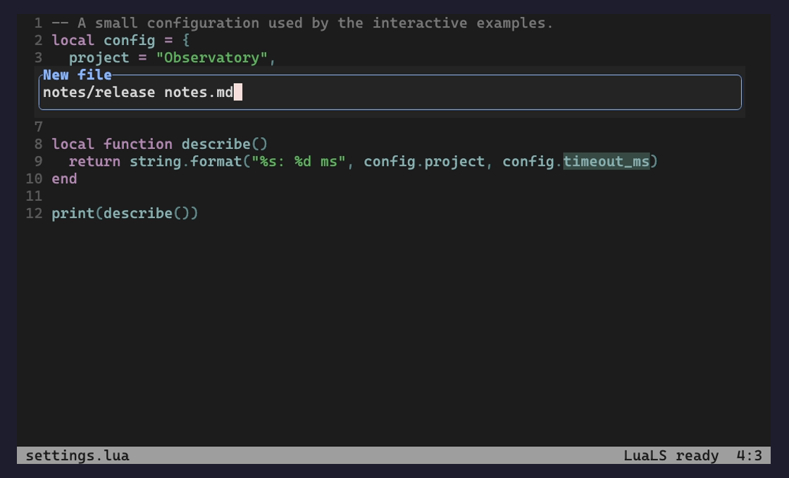
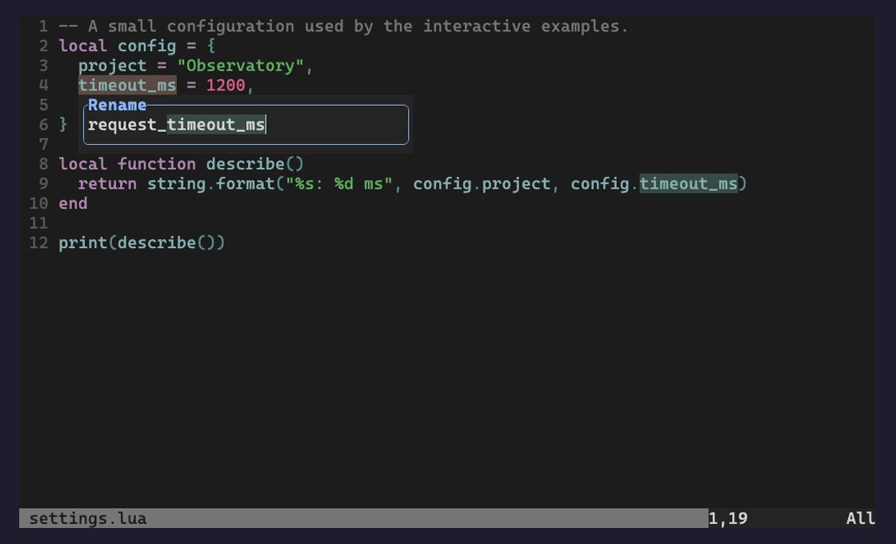
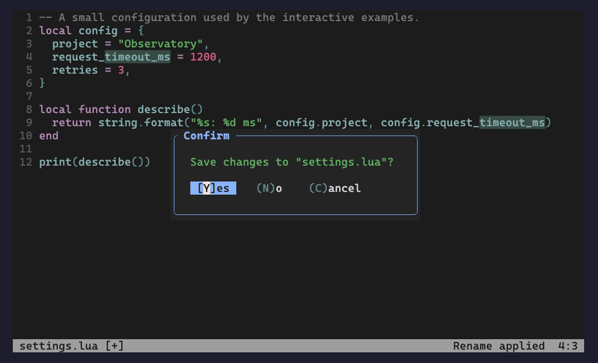

# input-tools.nvim

A small command-line UI for Neovim. Native editing, history and completion stay
in Neovim; input-tools draws the command line, interactive prompts and menus.

Requires **Neovim 0.10+**. No runtime dependencies.

- A bottom command-line float for `:`, `/`, `?` and `input()`.
- Unicode byte-accurate cursors, horizontal scrolling, expression/register input,
  nested command lines, multiline definition context and command-line history.
- Native command-line and insert-mode completion menus with selection tracking.
- Confirmation, numbered-choice and substitution prompts when messages are externalized.
- Optional Vim-mode inputs with real Normal/Insert editing and buffer-local controls.
- Optional cooperation with notification-tools; ordinary messages stay out of this plugin.
- Resize/theme updates, repeated setup/teardown and restoration of the native UI.

## Everyday workflows

Real Neovim 0.12.6 terminal screenshots from an isolated Lua project. The demo uses
`habamax` with explicit float highlights; the plugin follows your own colorscheme.
The rename input sends the accepted name to native LSP and a real LuaLS server.

| Native search | Confirm individual replacements |
| --- | --- |
|  |  |
| **Choose an export format** | **Create a file with a space-containing path** |
|  |  |
| **Rename beside the source cursor** | **Confirm unsaved changes before quitting** |
|  |  |

[Run the scenario checks or reproduce these screenshots](docs/workflows.md).

## Install

With lazy.nvim:

```lua
{
  "Jacky-Lzx/input-tools.nvim",
  main = "input-tools",
  lazy = false,
  opts = {},
}
```

Or add this repository to `runtimepath` and call:

```lua
require("input-tools").setup()
```

`require()` alone does not attach UI or replace functions. Input-tools does not
replace `vim.ui.input`, `vim.ui.select`, `vim.notify`, editing keymaps or LSP handlers.
Neovim's default input/select implementations already use its native input engine.
Prompts go through that engine; the plugin draws them without answering confirmations.

Use `:checkhealth input-tools` to inspect the current owners.

### blink.cmp

Command-line completion menus follow the input window automatically. Input-tools
publishes the `vim.g.ui_cmdline_pos` screen-position convention consumed by
Blink's default `completion.menu.cmdline_position`; no Blink dependency, patch
or early loading is needed. Keep Blink's command-line menu enabled as usual.
Custom `cmdline_position` callbacks must honor this position to follow the UI.
The position updates with layout/scrolling and is released when input closes;
teardown restores the previous value only while input-tools still owns it.

Blink normally aligns candidate text, allowing its icons/padding to extend left
of the input and its top border to share the input's bottom border. To align the
**outer window frames** instead, merge these options into Blink's configuration:

```lua
-- In Blink's lazy.nvim opts function, after input-tools is on runtimepath:
opts.completion = opts.completion or {}
local menu = opts.completion.menu or {}
opts.completion.menu = vim.tbl_deep_extend(
  "force", menu, require("input-tools.blink").menu_config(menu)
)
```

This configures Blink's public position/direction callbacks, aligns both left
borders, and places the menu completely below or above the input's border. It
compensates Blink's renderer alignment offset without changing the columns,
icons or padding. The optional adapter reads that offset from an already-loaded
renderer through a guarded internal accessor. Insert-mode completion retains its
existing direction callback and layout. The helper falls back to the supplied
positioning callbacks (or native positioning) when input-tools is disabled.
When layout changes, an already-loaded Blink menu is repositioned on the next
event-loop turn. This guarded adapter uses Blink's internal menu positioning
function because it has no public reposition-only API; it never loads or patches
Blink and leaves completion sources, selection and keymaps with Blink.

## Pair with notification-tools

Enable native-message capture in notification-tools:

```lua
require("notification-tools").setup({
  messages = { enabled = true },
})
require("input-tools").setup()
```

The plugins have separate jobs:

- **input-tools** owns command-line input, prompts, completion and externalized status widgets.
- **notification-tools** owns notifications, non-interactive native messages, progress and history.

Input-tools calls `attach_messages()` only after its renderer is attached, then
releases that handle **before** detaching its renderer. Without notification-tools,
it works alone and native messages retain their original display. It never loads
notification-tools or changes that plugin's configuration. If `messages.enabled`
is false, there is no message handoff.

Both loading orders work with a notification-tools version providing the
`NotificationToolsReady` User event. Reconfiguring notification-tools triggers a
fresh handoff; reconfiguring input-tools releases and reacquires its handle. For
older notification-tools versions with `attach_messages()` but no ready event,
load notifications first, or call `require("input-tools").sync_notifications()`
after its setup. See [examples/lazy.lua](examples/lazy.lua).

Disable competing external UI owners, including Noice's command-line/messages/
popup-menu UI. A GUI already externalizing the command line or an enabled popup
menu is detected before setup changes the working instance. Lua UI subscriptions
cannot currently be enumerated, so other Lua owners must be disabled explicitly.

## Configuration

```lua
require("input-tools").setup({
  notifications = true, -- Join an already loaded, opted-in notification-tools.
  return_prompt = "auto", -- "show" preserves the native hit-enter interaction.
  status = true, -- Mode, showcmd and ruler widgets when messages are externalized.
  window = {
    border = "rounded", -- single, double, solid, none and "" also supported.
    max_width = 80,
    max_height = 8,
    bottom = 1,
    -- row = 3, -- Optional zero-based top offset; overrides bottom placement.
    winblend = 0,
    zindex = 250,
  },
  popupmenu = {
    enabled = true, -- Applies to native command-line AND insert-mode completion.
    border = "single",
    min_width = 1,
    align = "frame", -- "cursor" aligns with the current command argument.
    scrollbar = true,
    max_height = 8,
    max_width = 60,
  },
})
```

The command line is centered near the bottom by default. Set `window.row = 3`
for a top-centered command palette like Noice's `command_palette` preset. The
position is clamped on small screens. Completion menus appear below a top input
or above a bottom input, falling back to available space without overlapping it.
Native menus align their outer left frame with the input by default; `align="cursor"`
anchors to the completion start instead. Insert-mode menus remain cursor-relative.
Borders and width limits apply independently of the input. Overflowing candidates
are clipped by display cells and a scrollbar shows the visible range. Menus prefer
a side with enough space, shrink when necessary and stay outside the input frame.
Blink keeps its own border/width/scrollbar options; its adapter also shifts a wide
menu left when the input sits near the right screen edge.
Long input scrolls horizontally
with the cursor; multiline prompts/context use at most `max_height` rows. Menu
selection, acceptance and cancellation use Neovim's existing keys and settings.
Use `wildoptions=pum` and `wildmode=full` if you want the native command-line
completion engine to emit a popup menu. Input-tools does not change these options.
With popup-menu capture disabled, Neovim/another owner controls menu display.

Hit-enter prompts are acknowledged automatically by default; this avoids an
extra pause for messages already shown in notification-tools. Set
`return_prompt="show"` to wait for the user's Enter key. Confirmations, numbered
choices and substitution decisions always wait for the user's answer. Confirmation
bodies remain visible with their choices until answered; long paths wrap to fit.
Confirmation dialogs open in the editor center with inner spacing and a separate
button row. The default choice is highlighted; other accelerators remain visible.
Width follows the content between 36 and 64 cells, with long paths wrapping inside
the dialog. Native save/discard/cancel shortcuts are unchanged. Override
`profiles.confirm` (`width`, `min_width`, `max_width`, `row`, `title`) to customize
it; an explicit width disables automatic sizing. `row="center"` is available in
any window profile. Unrecognized choice text is preserved verbatim.
On older Neovim, unnamed messages emitted in a native `r`/`rm` prompt state are
treated as interactive too; this keeps `inputlist()` choices visible while the
editor waits for a number.

Float colors use `InputToolsNormal`, `InputToolsBorder`, `InputToolsPrompt`,
`InputToolsMenu`, `InputToolsSelection`, `InputToolsTitle` and `InputToolsStatus`.
`InputToolsMenuBorder` uses the menu background, keeping popup borders separate
from command-float surfaces. Explicit highlight overrides remain authoritative.
Confirmation styling uses `InputToolsConfirmText`, `InputToolsConfirmChoice`,
`InputToolsConfirmDefault` and `InputToolsConfirmKey`. They link to native
theme groups; override them with `nvim_set_hl`, including from a `ColorScheme`
autocmd. The UI preserves native highlighted chunks in command input, multiline context
and interactive prompts, including `input()` highlight callbacks. It does not
add a syntax parser or change command-line completion sources. New protocols provide group IDs
directly. On older Neovim, a guarded LuaJIT integer-only bridge resolves matching
highlight groups; if that symbol is unavailable or no group matches, the text
remains readable with the base color. No C structure layouts are assumed. Its terminal cursor uses Neovim's experimental
`nvim__redraw` cursor support, available in the supported versions.

### Input-specific layouts

`window` remains the shared default. Optional `profiles` override it for
`command` (`:`), `search` (`/` and `?`), `input` (`input()`), `expression` (`=`)
and `confirm` (interactive prompts). Existing configurations keep their layout.

```lua
require("input-tools").setup({
  window = { row = 3 },
  profiles = {
    search = { width = 0.4, min_width = 24, max_width = 60, title = "Search" },
    input = { width = 50, title = "Input", title_pos = "center" },
  },
})
```

`width` is a positive cell count or a fraction in `(0, 1]` of editor columns.
It is bounded by `min_width`, `max_width` and available screen space. Without
`width`, the existing `max_width` behavior is preserved. `row=false` explicitly
restores bottom placement in a profile even if the base window has a top offset.
`col` is a signed offset from horizontal center. `title` is an upper border title
(`false` by default). `title_pos` selects `"left"`, `"center"` (default) or
`"right"`; borderless windows omit configured titles. Both position and size clamp
on small screens.

## API and lifecycle

```lua
local input = require("input-tools")
input.setup(opts)          -- Validate, replace the old instance, then attach.
input.enable()            -- Resume the last successful config; no-op if active.
input.disable()           -- Restore native input, retaining config for enable.
input.toggle()
input.is_enabled()         -- Whether our UI subscription is active.
input.status()             -- Ownership, window, Blink state and last render error.
input.get_window()         -- Visible input window ID, or nil; does not load UI.
input.get_layout()         -- Independent snapshot of visible input geometry, or nil.
input.input({ prompt = "Name: ", default = "old" }, function(value)
  -- value is nil on cancellation; an accepted empty string remains "".
end)
input.sync_notifications() -- Retry the optional handoff after producer setup.
input.teardown()           -- Release messages, UI subscription, floats/autocmds.
```

After setup, `:InputTools enable`, `disable`, `toggle` and `status` provide the
same controls. The command remains available while disabled. `status()` and
`:checkhealth input-tools` inspect already-loaded Blink without activating it.
A successful setup clears the recorded renderer error. Invalid reconfiguration
preserves both the active instance and the configuration used by `enable()`.

### General input API

`input.input(opts, on_confirm)` provides a shared input API even when another
plugin owns `vim.ui.input`. `vim_mode=false` (default) uses Neovim's native
command-line input engine. `vim_mode=true` opens a real editable scratch buffer
with native Normal/Insert editing. Both use the `profiles.input` layout and
per-call `width`, `position`, `title`, `title_pos`, `prompt` and `default` options.
Neither replaces `vim.ui.input` or enables the global command-line renderer.
Native input falls back to Neovim's display when the renderer is disabled;
explicit Vim-mode input can open independently of that renderer.

Any consumer can call the same public API directly:

```lua
require("input-tools").input({
  vim_mode = true,
  position = "cursor",
  width = 32,
  title = "Project name",
  title_pos = "center",
  default = "demo",
}, function(value)
  if value ~= nil then
    -- Use the accepted value (including an empty string).
  end
end)
```

`position="cursor"` opens beside the caller's buffer cursor, below its screen
line when space permits and above otherwise. The frame shifts horizontally to
fit the editor. It anchors to the original buffer position rather than following
the input cursor while typing, and updates after source scrolling, split changes
and editor resizing. Screen coordinates account for wrapping, tabs, wide characters
and window decorations. If that source window/buffer is no longer visible, the
configured editor layout is used. There is no polling timer.

`position="editor"` (default) retains the configured `window.row`/`window.col`
layout. Cursor positioning overrides those coordinates while retaining the input
profile's size, border, title and blending. Native completion menus and Blink's
position adapter use the same final frame geometry.

`width` optionally overrides the content width for this call (display cells or
an editor-width fraction in `(0, 1]`), within the profile's `min_width`/`max_width`
and screen limits. Omit it to keep the configured width. Long values scroll
horizontally without truncating the value passed to the callback.

`title` appears in the upper border. `title_pos` is `"left"`, `"center"` or
`"right"`, defaulting to `profiles.input.title_pos` / `window.title_pos` (center).
These options apply only to this call and override the input profile. `title=false`
suppresses a configured title. `prompt` remains an independent inline label; omit
it for a title-only input with only the value on the editable line. When there is
no border or the renderer is disabled, title-only inputs use an inline label.
Titles do not leak to later calls or nested command-line expressions.

In Vim mode the buffer starts in Insert at the end of `default`. `Esc` switches
to Normal for motions, operators such as `ciw`, and undo/redo. `Enter` confirms
from Normal or Insert (with an active completion menu it accepts that item first).
`Ctrl-C` cancels from either mode; `Esc` in Normal also cancels. Closing the input,
leaving its window, calling `teardown()`/`disable()`, or opening a newer Vim input
cancels it exactly once. Only input-buffer mappings are installed. The source
window regains focus before the scheduled callback runs; accepted empty text is
`""`, cancellation is `nil`. If the user leaves for another window, that chosen
window keeps focus.

Vim-mode calls return an optional handle with an idempotent `cancel()` method;
native command-line calls return `nil`. `get_window()` and `get_layout()` expose
the editable float too (`layout.vim_mode=true`), and lifecycle events still apply.
Both modes accept `completion` and `highlight`. In Vim mode, `completion` installs
a buffer-local `completefunc`: use `<C-x><C-u>` for native completion. Built-in
kinds such as `file`, `dir`, `command` and `cmdline` use `getcompletion()`;
`custom,Function` and `customlist,Function` receive the current argument, full
input and byte cursor position. Callback names may use `v:lua.`. No completion
specification means external Blink suggestions remain disabled in this scratch
input; rename therefore keeps its existing editing behavior.

`highlight` receives the full value (including newlines) and returns sorted
`{start_byte, end_byte, "Group"}` spans, using zero-based byte offsets and exclusive
ends like native `input()`. Spans may cross lines but must respect UTF-8 character
boundaries. Results are refreshed after text changes and colorscheme changes;
cursor movement does not rerun the callback. A bad completion/highlight callback
warns once per input and leaves the input usable.

For Blink-powered suggestions in Vim input, add the optional source adapter in
Blink's opts function (alongside the existing command-line menu adapter):

```lua
opts.sources = require("input-tools.blink").sources_config(opts.sources)
```

This uses Blink's built-in `complete_func` source only for `input-tools-input`.
Other filetypes retain their sources and keymaps. It works when opening the first
input lazy-loads Blink on `InsertEnter`. Without this adapter, declared completion
still works through native `<C-x><C-u>`. With either menu, the first `Enter` accepts
the completion; the next confirms the input. Input-tools retains its local Enter
mapping after `InsertEnter`; Blink still owns its navigation keys. The adapter
does not load Blink.

Input-tools owns the input API and renderer; consumers own the action performed
with the value. Lsp-tools uses this general API for rename automatically when it
is available, without a configuration callback or a rename-specific input API.

### Layout API and events

`get_layout()` returns a copy containing `win`, `buf`, `kind`, `editable`,
`row`, `col`, `width`, `height`, `outer_width`, `outer_height`, `border`, `text`
and `cursor`. Rows/columns are **zero-based screen cells**. `row`/`col` are the
outer frame origin; `width`/`height` exclude its border. `text` is the native
command-text origin adjusted for scrolling (its column can be negative), and
`cursor` is the actual screen cursor. No command contents are included.
Closing or disabling the input makes the API return `nil` immediately.

```lua
vim.api.nvim_create_autocmd("User", {
  pattern = { "InputToolsOpen", "InputToolsLayoutChanged", "InputToolsClose" },
  callback = function(event)
    local layout = event.data.layout
    -- Open/change: use layout to position a companion UI.
    -- Close: layout describes the previous input; its window may be invalid.
  end,
})
```

Events run on the next event-loop turn after rendering. Repeated changes are
coalesced to the latest snapshot, so an input opened and closed within the same
turn may produce no event. Open fires when an input window becomes visible;
layout-changed covers geometry, input kind, scrolling and cursor movement.
Close carries the previous snapshot. Callback mutations cannot alter renderer
state; callback errors are reported without disabling input. The Blink adapter
uses this public geometry API for the input anchor.

No idle timer runs. UI events update native command-line state and redraw its
non-focusable floats; Vim-mode API inputs use their own focusable buffers. Repeated identical events do not schedule redraw loops.
Fast-event work is deferred. Rendering failures disable the UI and release the
message handoff, restoring native input rather than leaving an invisible prompt.
Invalid configuration is rejected before replacing a working instance.

The UI subscription uses Neovim's experimental `vim.ui_attach` protocol. A
consumer that replaces input-tools should call `teardown()` first. This plugin
does not capture ordinary output, implement a message history, or manage LSP UI.

## Development

```sh
sh tests/run.sh
NOTIFICATION_TOOLS_ROOT=../notification-tools.nvim sh tests/run.sh
INPUT_TOOLS_BLINK_ROOT=/path/to/blink.cmp sh tests/run.sh
python3 scripts/check_types.py
# Optional: semantic rename against a real LuaLS server.
INPUT_TOOLS_LUA_LS="$(command -v lua-language-server)" python3 tests/workflow_ui.py
```

Runtime tests require Neovim, Python 3 and StyLua. Optional type checks require
LuaLS. UI tests attach a real RPC UI, drive the native editing engine and inspect
rendered grid/cursor events. Integration tests cover native-message capture,
visible interactive prompts, both loading orders, reconfiguration and teardown.
They do not depend on an installed Neovim configuration.

## License

MIT

## Loading and redraw cost

Keep the small UI owner enabled at startup when pairing with notification-tools.
The native renderer/text decoder and the editable-buffer renderer load on demand;
opening only Vim-mode input does not load the native renderer. Window profiles are
merged once per effective style. Cursor movement preserves buffer text and
highlights and refreshes only the affected window. Blink repositioning is queued
only while its already-loaded command-line menu is visible.

See [performance measurements](docs/performance.md) for the reproducible isolated
RPC-UI benchmark (`python3 scripts/benchmark.py`) and its timing limits.
