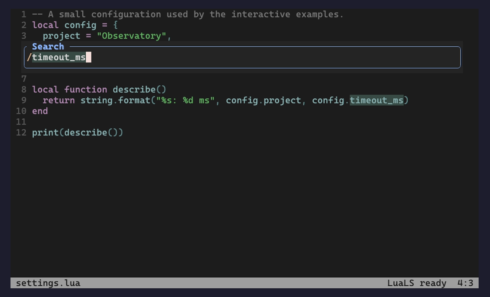
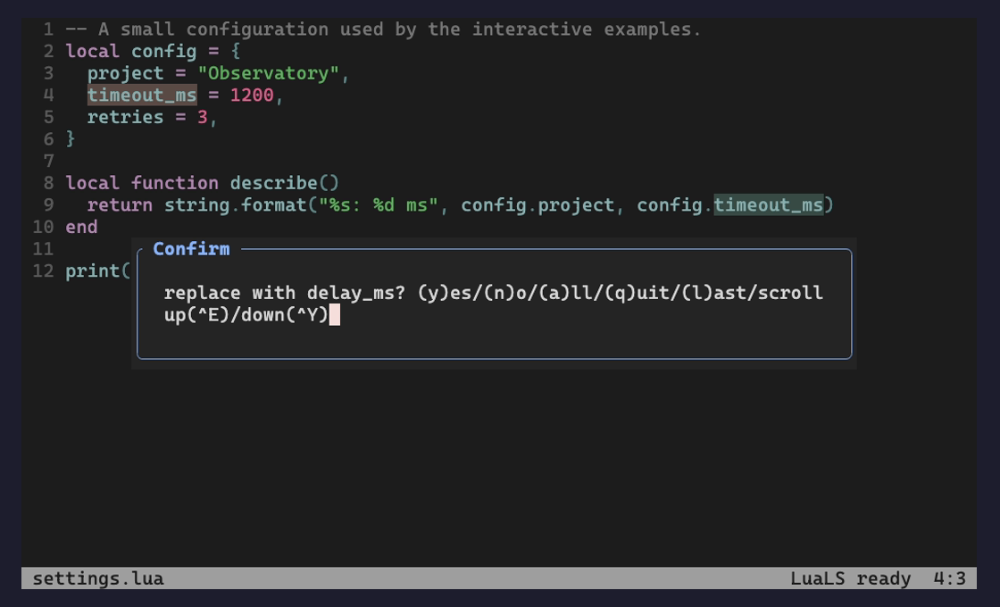
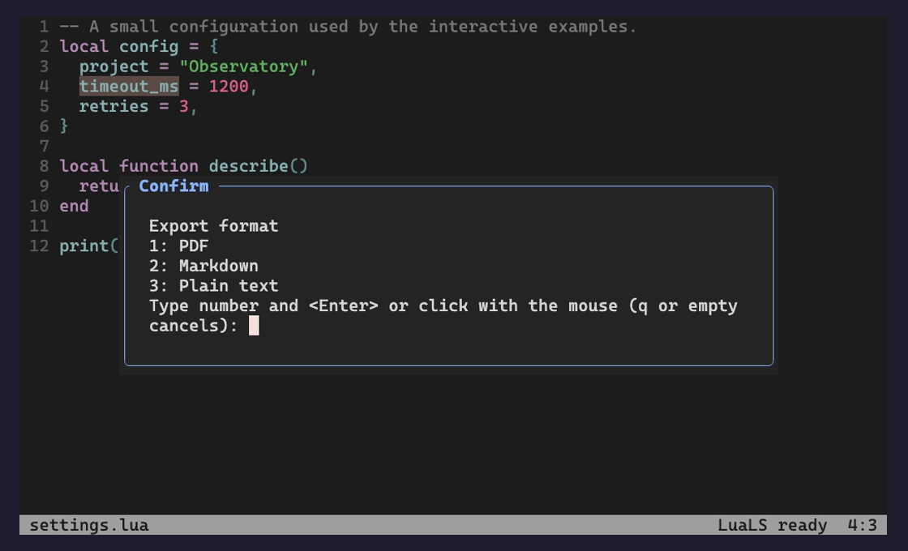
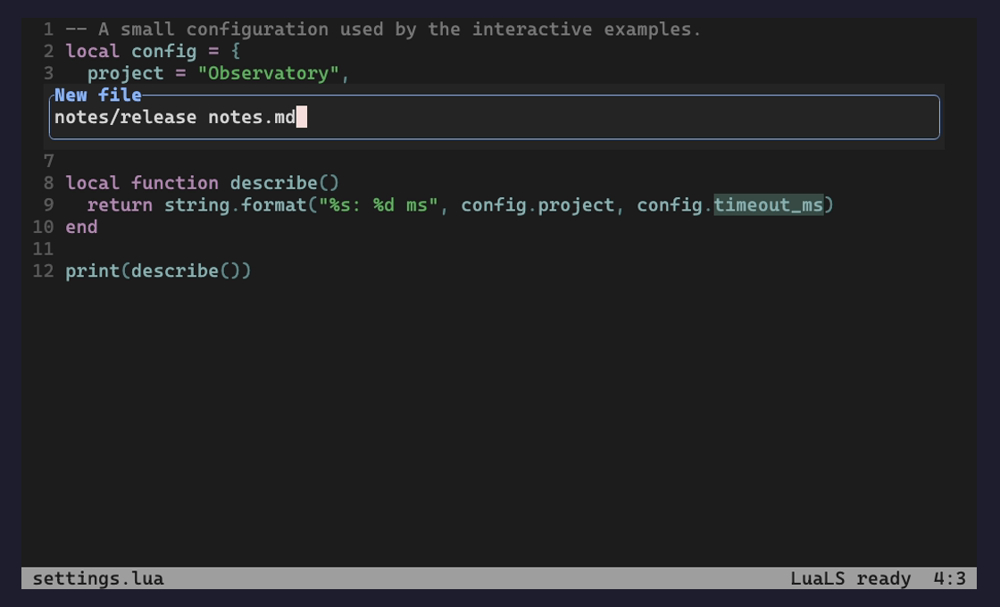
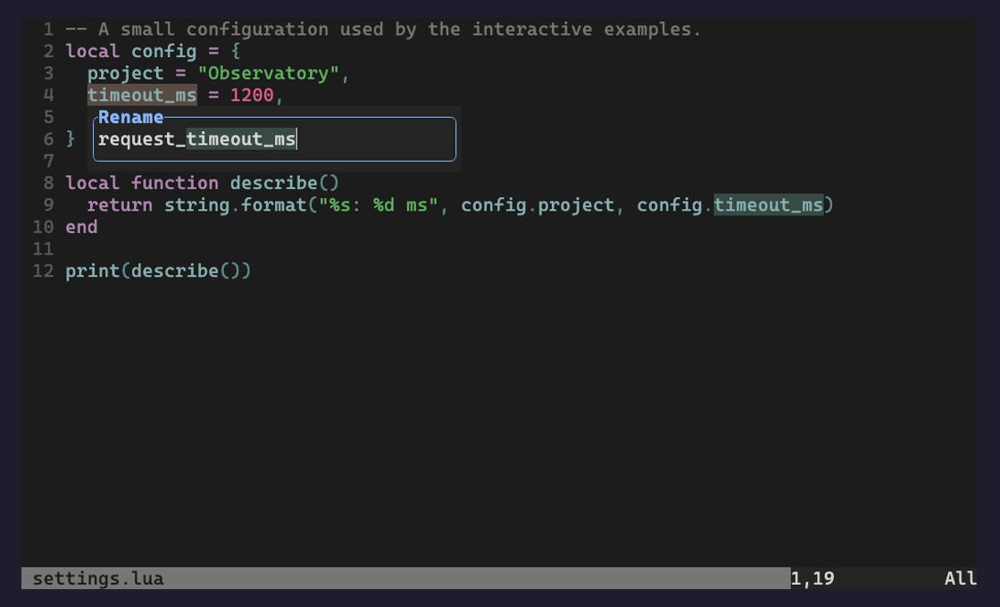
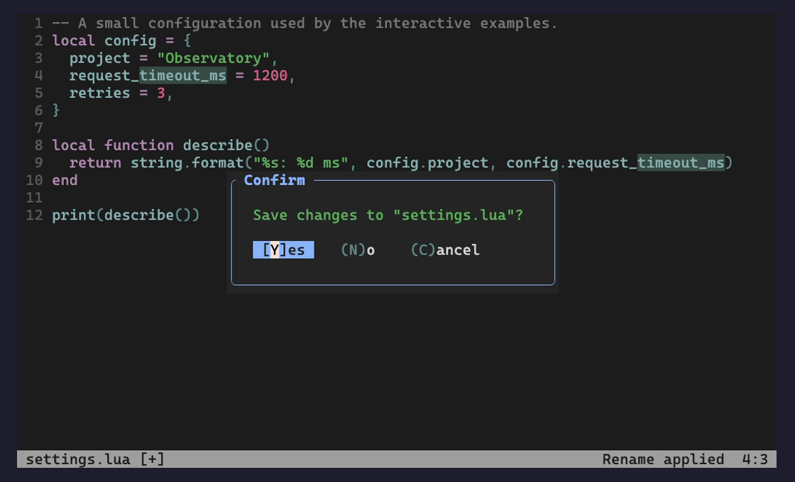

# Screenshots

[Quick start](../README.md)

Existing captures from real Neovim sessions. See the linked reproduction tools
where supplied by the original workflow documentation.

Native forward search for timeout_ms

Native substitute confirmation while reviewing a Lua configuration

Persistent native vim.ui.select choices for export format

Native input API showing notes/release notes.md

Vim-mode rename input used with a real LuaLS server

Unsaved-file quit confirmation after the semantic rename
