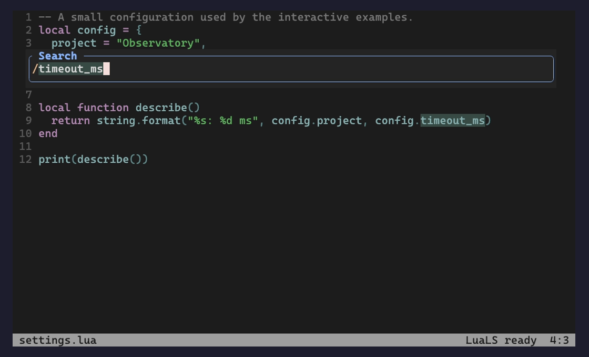
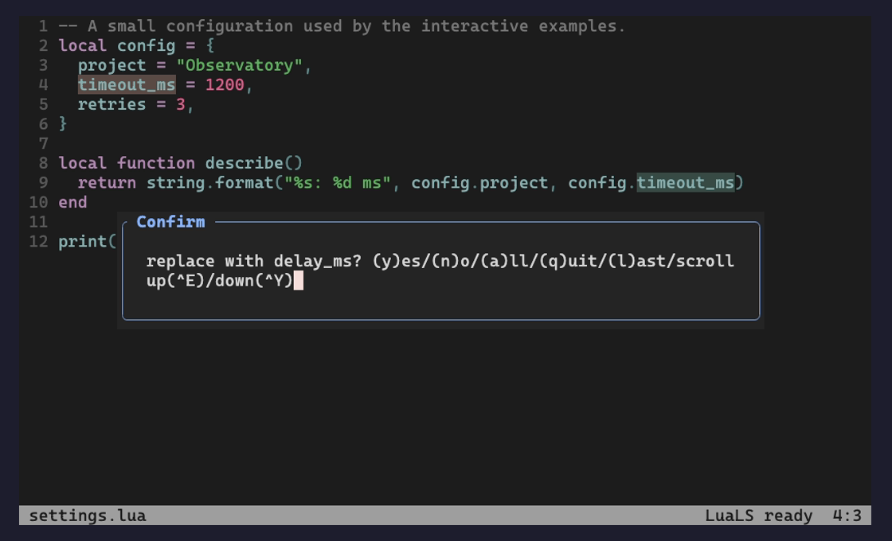
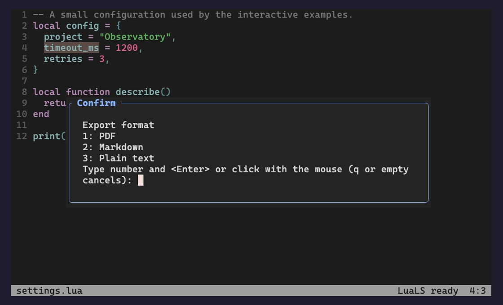
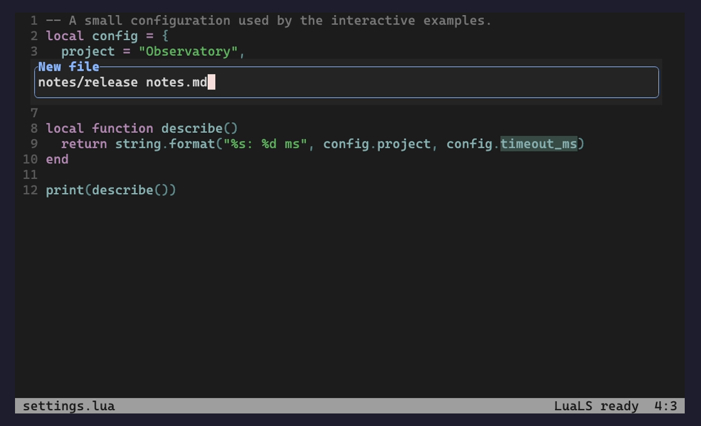
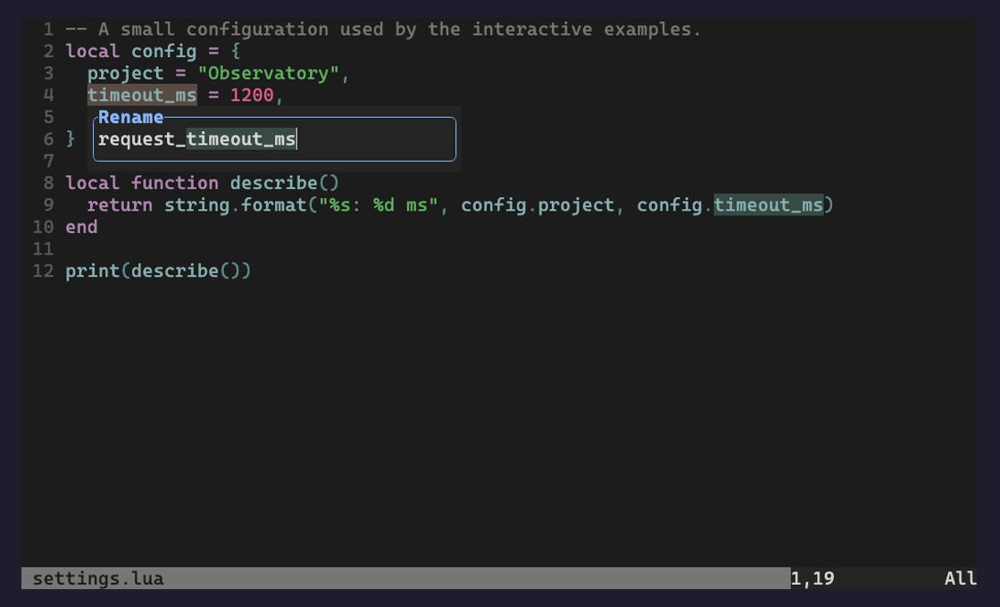
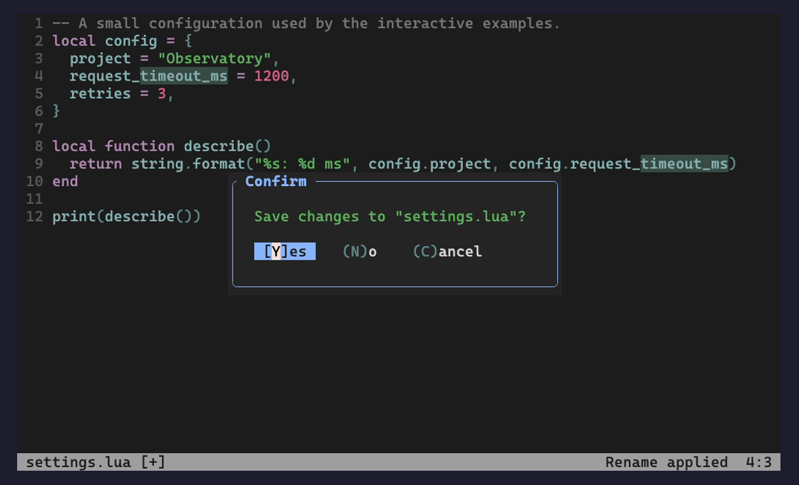

# Workflow and integration guide

[Quick start](../README.md) · [Complete reference](input-tools.txt)

Configuration defaults and API contracts are maintained in the help reference.
The examples here illustrate particular workflows.

## Everyday workflows

Real Neovim 0.12.6 terminal screenshots from an isolated Lua project. The demo uses
`habamax` with explicit float highlights; the plugin follows your own colorscheme.
The rename input sends the accepted name to native LSP and a real LuaLS server.

| Native search | Confirm individual replacements |
| --- | --- |
|  |  |
| **Choose an export format** | **Create a file with a space-containing path** |
|  |  |
| **Rename beside the source cursor** | **Confirm unsaved changes before quitting** |
|  |  |

[Run the scenario checks or reproduce these screenshots](../docs/workflows.md).

## Installation details

With lazy.nvim:

```lua
{
  "Jacky-Lzx/input-tools.nvim",
  main = "input-tools",
  lazy = false,
  opts = {},
}
```

Or add this repository to `runtimepath` and call:

```lua
require("input-tools").setup()
```

`require()` alone does not attach UI or replace functions. Input-tools does not
replace `vim.ui.input`, `vim.ui.select`, `vim.notify`, editing keymaps or LSP handlers.
Neovim's default input/select implementations already use its native input engine.
Prompts go through that engine; the plugin draws them without answering confirmations.

Use `:checkhealth input-tools` to inspect the current owners.

### blink.cmp

Command-line completion menus follow the input window automatically. Input-tools
publishes the `vim.g.ui_cmdline_pos` screen-position convention consumed by
Blink's default `completion.menu.cmdline_position`; no Blink dependency, patch
or early loading is needed. Keep Blink's command-line menu enabled as usual.
Custom `cmdline_position` callbacks must honor this position to follow the UI.
The position updates with layout/scrolling and is released when input closes;
teardown restores the previous value only while input-tools still owns it.

Blink normally aligns candidate text, allowing its icons/padding to extend left
of the input and its top border to share the input's bottom border. To align the
**outer window frames** instead, merge these options into Blink's configuration:

```lua
-- In Blink's lazy.nvim opts function, after input-tools is on runtimepath:
opts.completion = opts.completion or {}
local menu = opts.completion.menu or {}
opts.completion.menu = vim.tbl_deep_extend(
  "force", menu, require("input-tools.blink").menu_config(menu)
)
```

This configures Blink's public position/direction callbacks, aligns both left
borders, and places the menu completely below or above the input's border. It
compensates Blink's renderer alignment offset without changing the columns,
icons or padding. The optional adapter reads that offset from an already-loaded
renderer through a guarded internal accessor. Insert-mode completion retains its
existing direction callback and layout. The helper falls back to the supplied
positioning callbacks (or native positioning) when input-tools is disabled.
When layout changes, an already-loaded Blink menu is repositioned on the next
event-loop turn. This guarded adapter uses Blink's internal menu positioning
function because it has no public reposition-only API; it never loads or patches
Blink and leaves completion sources, selection and keymaps with Blink.

## Pair with notification-tools

Enable native-message capture in notification-tools:

```lua
require("notification-tools").setup({
  messages = { enabled = true },
})
require("input-tools").setup()
```

The plugins have separate jobs:

- **input-tools** owns command-line input, prompts, completion and externalized status widgets.
- **notification-tools** owns notifications, non-interactive native messages, progress and history.

Input-tools calls `attach_messages()` only after its renderer is attached, then
releases that handle **before** detaching its renderer. Without notification-tools,
it works alone and native messages retain their original display. It never loads
notification-tools or changes that plugin's configuration. If `messages.enabled`
is false, there is no message handoff.

Both loading orders work with a notification-tools version providing the
`NotificationToolsReady` User event. Reconfiguring notification-tools triggers a
fresh handoff; reconfiguring input-tools releases and reacquires its handle. For
older notification-tools versions with `attach_messages()` but no ready event,
load notifications first, or call `require("input-tools").sync_notifications()`
after its setup. See [examples/lazy.lua](../examples/lazy.lua).

Disable competing external UI owners, including Noice's command-line/messages/
popup-menu UI. A GUI already externalizing the command line or an enabled popup
menu is detected before setup changes the working instance. Lua UI subscriptions
cannot currently be enumerated, so other Lua owners must be disabled explicitly.

## Development

```sh
sh tests/run.sh
NOTIFICATION_TOOLS_ROOT=../notification-tools.nvim sh tests/run.sh
INPUT_TOOLS_BLINK_ROOT=/path/to/blink.cmp sh tests/run.sh
python3 scripts/check_types.py
# Optional: semantic rename against a real LuaLS server.
INPUT_TOOLS_LUA_LS="$(command -v lua-language-server)" python3 tests/workflow_ui.py
```

Runtime tests require Neovim, Python 3 and StyLua. Optional type checks require
LuaLS. UI tests attach a real RPC UI, drive the native editing engine and inspect
rendered grid/cursor events. Integration tests cover native-message capture,
visible interactive prompts, both loading orders, reconfiguration and teardown.
They do not depend on an installed Neovim configuration.

## Loading and redraw cost

Keep the small UI owner enabled at startup when pairing with notification-tools.
The native renderer/text decoder and the editable-buffer renderer load on demand;
opening only Vim-mode input does not load the native renderer. Window profiles are
merged once per effective style. Cursor movement preserves buffer text and
highlights and refreshes only the affected window. Blink repositioning is queued
only while its already-loaded command-line menu is visible.

See [performance measurements](../docs/performance.md) for the reproducible isolated
RPC-UI benchmark (`python3 scripts/benchmark.py`) and its timing limits.
